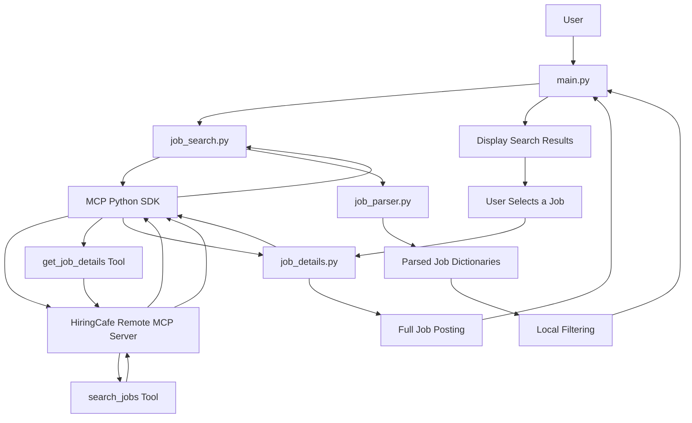

# HiringCafe Job Finder MCP

A Python command-line application that connects to HiringCafe's remote Model Context Protocol (MCP) server to search job listings, filter results by employment type, and retrieve complete job postings.

This project was built as a hands-on learning exercise to understand MCP clients, remote tool discovery, tool execution, asynchronous Python, and response processing.


## Overview

HiringCafe Job Finder MCP provides a simple terminal interface for searching job listings through HiringCafe's remote MCP server.

The application lets users enter a job title, optionally specify a location, select an employment type, and choose how many results to display. Users can then select a listing to retrieve its full job description and other available details.

Instead of building a job-search backend from scratch, the application uses MCP to access tools exposed by an existing remote server.

### Project Goals

- Learn how to connect a Python application to a remote MCP server.
- Discover MCP tools and inspect their input schemas.
- Invoke tools with the correct arguments.
- Process Markdown responses returned by MCP tools.
- Implement local filtering and result selection.
- Combine multiple MCP tool calls into one application workflow.

## Features

### Job Search

- Search jobs by title or keyword.
- Optionally provide a location.
- Choose an employment type: Internship, Full Time, Contract, or Any.
- Specify the number of results to display.
- Request up to 25 candidates for local filtering.

### Job Listings

The application displays available information, including:

- Job title
- Company
- Location
- Workplace arrangement
- Compensation
- Employment type
- Application URL

### Full Job Details

Select a job by its displayed number to retrieve its complete posting. The returned information may include:

- Full job description
- Requirements
- Compensation
- Employment type
- Seniority level
- Application link

The exact fields depend on the information returned by HiringCafe.

### Local Processing

- Parse Markdown listings into Python dictionaries.
- Filter listings by employment type.
- Display up to the requested number of matching results.
- Handle tool errors and invalid job selections.

## Tech Stack

| Technology | Purpose |
|---|---|
| Python | Application logic |
| MCP Python SDK | Connect to the remote MCP server and invoke tools |
| uv | Dependency and project environment management |
| HiringCafe MCP | Remote job search and job details |
| PowerShell | Development and terminal execution |

## Architecture

The application follows a client-server architecture. It does not host its own MCP server; it connects to HiringCafe's existing remote MCP endpoint.



### Architecture Flow

1. `main.py` collects search criteria from the user.
2. `job_search.py` calls the remote `search_jobs` tool.
3. The MCP server returns job listings as Markdown text.
4. `job_parser.py` converts the listings into Python dictionaries.
5. The application applies local employment-type filtering.
6. Matching results are displayed in the terminal.
7. The user selects a job.
8. `job_details.py` calls `get_job_details` with that job's ID.
9. The returned full posting is displayed.

## Project Structure

```text
HiringCafe_JobFinder_MCP/
├── main.py
├── job_search.py
├── job_parser.py
├── job_details.py
├── inspect_tools.py
├── pyproject.toml
├── uv.lock
└── README.md
```

This is the expected project layout. Update it if your final repository contains a different set of files.

### File Responsibilities

| File | Responsibility |
|---|---|
| `main.py` | Collects input, coordinates the workflow, displays results, and handles job selection |
| `job_search.py` | Calls `search_jobs`, processes the response, and applies employment-type filtering |
| `job_parser.py` | Parses Markdown job listings into Python dictionaries |
| `job_details.py` | Calls `get_job_details` to retrieve a complete posting |
| `inspect_tools.py` | Inspects available MCP tools and their input schemas; useful during development |
| `pyproject.toml` | Defines project metadata and dependencies |
| `uv.lock` | Records resolved dependency versions |
| `README.md` | Project documentation |

## How It Works

### 1. Collect Search Criteria

The application asks the user for:

- Job title or keyword
- Location
- Employment type
- Number of jobs to display

Default values are provided for selected inputs.

### 2. Call the Search Tool

The application connects to HiringCafe's MCP server and invokes `search_jobs` with the selected criteria.

For example, a search may use arguments conceptually similar to:

```python
arguments = {
    "search": "AI/ML Engineer",
    "limit": 25,
    "employment_types": ["Internship"]
}
```

The actual arguments depend on the user's selections. Optional fields may be omitted when no corresponding filter is provided.

### 3. Parse the Response

The search tool returns Markdown text rather than a ready-made list of Python dictionaries.

The application extracts the textual content and passes it to `job_parser.py`, which converts the listings into dictionaries.

An illustrative parsed job could look like this:

```python
{
    "title": "AI/ML Engineer Intern",
    "company": "Example Company",
    "location": "Example Location",
    "workplace": "Hybrid",
    "compensation": "Not provided",
    "employment_type": "Internship",
    "url": "https://hiringcafe.com/job/...",
    "job_id": "example-job-id"
}
```

This is an example of the data structure, not a claim that these literal values were returned by the server.

### 4. Filter and Display Results

The application validates employment types locally and displays up to the requested number of matching jobs.

Requesting more candidates than the desired display count gives the local filter more results to examine, but does not guarantee that enough matches will be available.

### 5. Retrieve Full Job Details

When the user selects a result, the application retrieves its `job_id` and passes it to `get_job_details`.

The tool returns the full posting as textual content, which is displayed in the terminal.

## MCP Integration

### Remote Endpoint

The application connects to:

`https://hiringcafe.com/api/mcp`

### Tool 1: `search_jobs`

**Purpose:** Search HiringCafe job listings using supported search criteria.

The discovered schema includes the following arguments:

| Argument | Type | Purpose |
|---|---|---|
| `search` | String | Search keywords |
| `location` | String | Optional location filter |
| `employment_types` | Array of strings | Employment-type filters |
| `seniority_levels` | Array of strings | Seniority filters |
| `max_years_experience` | Number | Maximum years of experience |
| `posted_within_days` | Number | Posting recency filter |
| `limit` | Number | Number of results, up to 25 |

The current application uses the subset needed for its search workflow. Other supported filters can be added later.

### Tool 2: `get_job_details`

**Purpose:** Retrieve the complete posting for one job.

The tool requires the following argument:

| Argument | Type | Purpose |
|---|---|---|
| `job_id` | String | ID of the selected HiringCafe job |

The ID is obtained from the parsed search result.

### What This Demonstrates About MCP

This project demonstrates the client side of MCP:

1. Connect to an existing remote MCP server.
2. Discover available tools.
3. Inspect tool descriptions and input schemas.
4. Call tools with their required arguments.
5. Process the returned content.
6. Use tool results in a Python application.

## Installation

### Prerequisites

- Python
- [uv](https://docs.astral.sh/uv/)
- An internet connection

### 1. Clone the Repository

Replace the placeholder with your actual repository URL.

```powershell
git clone https://github.com/jawaidaakif01/HiringCafe_JobFinder_MCP.git
cd HiringCafe_JobFinder_MCP
```

### 2. Install Dependencies

From the project directory, run:

```powershell
uv sync
```

This synchronizes the project environment using the dependencies declared in `pyproject.toml` and the lockfile.

Ensure the MCP SDK and other required packages are declared in the project configuration.

### 3. Run the Application

```powershell
uv run main.py
```

No separate HiringCafe API key is configured by this application in the described workflow. Access still depends on the remote endpoint being reachable and available.

## Usage

Start the application:

```powershell
uv run main.py
```

Example input:

```text
=============================================
      HIRINGCAFE JOB FINDER
=============================================

Enter job title (default: AI/ML Engineer): AI/ML Engineer
Enter location (default: India):

Employment type:
1. Internship
2. Full Time
3. Contract
4. Any

Choose 1-4 (default: 1): 1

Number of jobs, 1-25 (default: 10): 10
```

The application searches for jobs and displays the returned matches.

An example listing may look like:

```text
Found 10 jobs(s):

1. AI/ML Engineer Intern
    Company: Example Company
    Location: Example Location
    Workplace: Hybrid
    Salary: Not provided
    Employment: Internship
    Apply: https://hiringcafe.com/job/...
```

The company and location above are illustrative. Live results vary.

### View a Job's Full Details

After the results are displayed, enter the number of a job:

```text
Enter a job number to view full details (or press Enter to exit): 1

Fetching full job details...
```

The complete posting returned by HiringCafe is then printed.

Press Enter without selecting a job to exit the details-selection step.

## Filtering Logic

The application combines remote search criteria with local validation.

### Employment-Type Matching

A job is considered an internship if its employment-type field contains `Internship`, even when other employment types are also listed.

| Employment type | Included in an Internship search? |
|---|---|
| `Internship` | Yes |
| `Full Time, Internship` | Yes |
| `Part Time, Internship` | Yes |
| `Full Time` | No |
| `Contract` | No |

The local filter normalizes case and whitespace before comparing individual employment-type values.

### Result Limits

The application requests up to 25 candidates, applies local filtering, and returns up to the requested number of matching jobs.

This improves the opportunity to find matches in the returned candidate set. It cannot guarantee that every available matching job will be found because the application only processes results returned by the remote server.

### Location Filtering

Location is passed to the remote search tool when the user supplies it. Search results can still include jobs outside the requested location, so location matching is a known limitation of the current implementation.

## Error Handling

The application includes basic handling for common failure cases.

### MCP Tool Errors

When a tool reports an error, the application extracts available error text and raises an exception with that information.

### Invalid Input

The command-line interface validates employment-type selections and the requested result count.

Invalid job numbers are handled without attempting to retrieve details for a nonexistent result.

### Empty Results

If no jobs remain after processing, the application displays a message rather than attempting to select a job from an empty list.

### Remote Service Failures

Network problems, unavailable tools, and inconsistent remote filtering can affect results. The application depends on HiringCafe's service for the underlying job data.

## Learning Outcomes

Building this project provided practical experience with:

### MCP Client Development
Connecting a Python application to an existing remote MCP server.

### Tool Discovery
Inspecting tool names, descriptions, input schemas, required arguments, and supported filters.

### Tool Execution
Invoking remote tools with arguments and processing their responses.

### Asynchronous Python
Using `async` functions and `asyncio` for MCP client operations.

### Response Parsing
Converting Markdown text into dictionaries that application logic can process.

### Local Validation
Implementing employment-type matching and result limits in Python.

### Multi-Tool Workflows
Combining job search and job detail retrieval into a single user-facing workflow.

### Debugging
Diagnosing issues involving argument names, filters, response formats, and remote-service behavior.

## Limitations

- Search quality depends on the data returned by HiringCafe.
- Local filtering can only examine the candidates returned by the server.
- Location filtering may not always return location-specific results.
- Job detail fields depend on the content provided by the remote service.
- The application is a command-line learning project, not a production job-search platform.
- It does not currently include persistent storage, scheduled alerts, a web interface, or automated job recommendations.

## Future Improvements

Possible extensions include:

- Improve location matching and validation.
- Add seniority and experience filters.
- Filter jobs by posting date.
- Add automated tests for parsing and filtering.
- Save and deduplicate job listings.
- Rank results by relevance.
- Add a graphical interface.
- Integrate the MCP tools into an LLM-powered agent.

These are optional extensions and are not required to complete the current learning project.